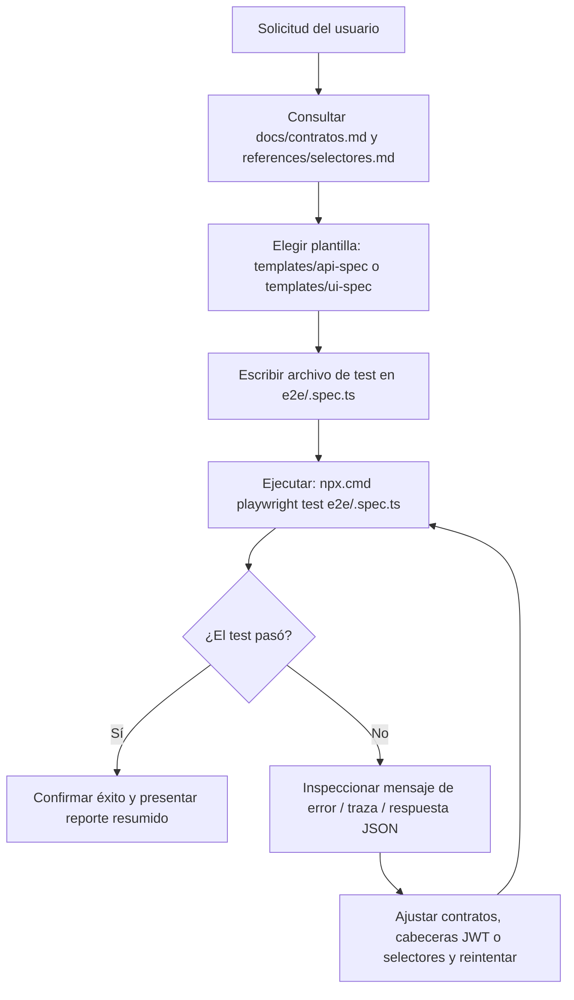

# Playwright Testing Skill (educar-app-movil)

Esta skill define el estándar y el flujo de trabajo para generar pruebas automatizadas con **Playwright** en el proyecto **`educar-app-movil`**, cubriendo tanto las pruebas de contrato HTTP contra la **API REST de Django** (`educar_pagina`) como pruebas de interfaz en emulación móvil (Expo Web / Viewport móvil).



---

## 1. Principios y Reglas de Calidad

1. **Aislamiento de Rol y Seguridad (RNF_M04):**
   - Todo test que consulte cuotas (`/api/cuotas/`) o servicios (`/api/servicios/inscripciones/`) debe validar que el token JWT del Padre/Tutor **solo reciba datos de sus propios hijos**, nunca de alumnos ajenos.
   - Todo endpoint protegido debe responder `401 Unauthorized` si no incluye el header `Authorization: Bearer <token>`.

2. **Verificación Estricta de Contratos:**
   - Validar que las respuestas de la API cumplan con los esquemas acordados en [docs/contratos.md](../../../docs/contratos.md).
   - Validar códigos de estado HTTP estándar: `200 OK`, `201 Created`, `400 Bad Request`, `401 Unauthorized`, `403 Forbidden`, `404 Not Found`.

3. **Pruebas de Subida Multipart (HU_M04 / RF_M08):**
   - El endpoint `POST /api/comprobantes/` debe ser probado enviando `cuota_id`, `importe`, `medio_pago` y un archivo multipart válido (PDF o imagen), validando que se asocie a la cuota y quede `en revisión`.
   - Las pruebas que crean comprobantes solo pueden ejecutarse contra Django local o un entorno aislado de pruebas; no deben cargar archivos en PythonAnywhere/producción.

4. **Selectores de Accesibilidad y TestID (UI Móvil):**
   - En vistas móviles (Expo Web / emulación), priorizar `page.getByTestId(...)` o accesibilidad: `page.getByRole('button', { name: /iniciar sesión/i })`, `page.getByLabel('Usuario o Correo')`.

---

## 2. Tipos de Pruebas Admitidas

### A. Pruebas de Contratos de API REST (`http://127.0.0.1:8000/api`)
Utilizan la fixture `{ request }` de Playwright para validar directamente los endpoints de Django REST Framework:
- **Autenticación (`HU_M01`):** `POST /api/auth/login/` devuelve `access` y `refresh` JWT, rol del usuario e información de perfil.
- **Cuotas e Historial (`HU_M02`, `HU_M03`):** `GET /api/cuotas/` devuelve cuotas discriminadas por estado (`pendiente`, `pagada`, `vencida`).
- **Carga de Comprobantes (`HU_M04`):** `POST /api/comprobantes/` recibe `cuota_id`, `importe`, `medio_pago` y `archivo` como multipart, y retorna estado `en revisión`.
- **Estados financieros (`HU_M02` a `HU_M04`):** `GET /api/cuotas/` incluye `estado_pago` y `motivo_rechazo` por comprobante; si el estado es `rechazado`, el motivo debe estar presente.
- **Servicios (`HU_M05`):** `GET /api/servicios/inscripciones/` devuelve deportes (máx. 2), transporte y comedor.
- **Reportes Financieros (`HU_M08` a `HU_M10`):** Consulta por rango de fechas y reportes administrativos.

### B. Pruebas de Interfaz Móvil (Emulación Móvil con Playwright)
Configurado con `devices['Pixel 5']` o `devices['iPhone 13']` para validar:
- Pantalla de Login, validación de campos obligatorios y mensaje de credenciales inválidas.
- Navegación entre pestañas (Cuotas, Pagos, Servicios, Perfil).
- Modal / pantalla de carga de comprobante y previsualización.

---

## 3. Protocolo de Ejecución en Windows

En PowerShell sobre Windows, invocar siempre Playwright a través de `npx.cmd` o `npm.cmd`:

```powershell
# Ejecutar un archivo de test específico
npx.cmd playwright test e2e/<nombre>.spec.ts

# Ejecutar todos los tests E2E y de contratos
npx.cmd playwright test

# Ejecutar con salida detallada en consola
npx.cmd playwright test --reporter=list

# Abrir el reporte gráfico de Playwright
npx.cmd playwright show-report
```

Para probar una carga exitosa, ejecutar contra el backend local y proporcionar una cuota local asociada al tutor de prueba:

```powershell
$env:EXPO_PUBLIC_API_URL = "http://127.0.0.1:8000/api"
$env:MOBILE_TEST_CUOTA_ID = "<id-cuota-local>"
npm.cmd run test:contracts -- --workers=1 --reporter=list
```

Las credenciales del tutor se pueden proporcionar con `MOBILE_TEST_TUTOR_USERNAME` y `MOBILE_TEST_TUTOR_PASSWORD`. La prueba de carga se omite fuera de `localhost`/`127.0.0.1` para evitar crear comprobantes en producción.

---

## 4. Ciclo de Auto-Reparación ante Fallos

Si un test falla durante la ejecución:

1. **Revisar el error:** Inspeccionar el status code devuelto (ej. 401, 400, 500), el JSON de error o el locator fallido.
2. **Inspeccionar el backend o el componente:** Verificar en `educar_pagina` o en `src/screens` si el payload o el nombre de campo difiere de `docs/contratos.md`.
3. **Corregir el código o el test:** Asegurarse de que el fallo no revele una violación de regla de negocio (ej. cuotas devueltas sin filtrar por tutor).
4. **Re-ejecutar:** Correr nuevamente `npx.cmd playwright test <archivo>` hasta obtener resultado en verde.
