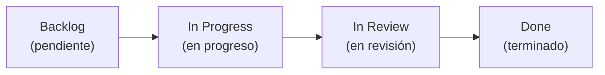

# Flujo de Trabajo Colaborativo — MaTech Grupo 10 (educar-app-movil)

Este documento define el procedimiento operativo estándar para el desarrollo de la aplicación móvil del Centro Educativo "Transformar para educar" entre **Fabio Ignacio Navarro** y **Maximiliano Joel Echeverría**.

---

## 1. Organización del Equipo

- **Fabio Ignacio Navarro:**
  - Coordinación de repositorio móvil, arquitectura en capas, Singleton Axios, servicios HTTP, gestión de tokens JWT con SecureStore y contratos con el backend Django.
- **Maximiliano Joel Echeverría:**
  - Diseño de interfaces móviles (UI/UX en Figma), componentes visuales reutilizables, pantallas por módulo (Cuotas, Comprobantes, Servicios, Reportes), accesibilidad y experiencia de usuario.
- **Responsabilidad compartida:**
  - Validación de reglas de negocio, pruebas en emuladores y dispositivos físicos, revisión de Pull Requests y Definition of Done (DoD).

---

## 2. Ciclo de Vida de una Tarea o Historia de Usuario

El flujo de trabajo implementa la **Regla Tripartita de Sincronización**:
`docs/backlog.md` $\iff$ GitHub Issue / PR $\iff$ Tablero Kanban (GitHub Projects).

### Paso a Paso:
1. **Selección:** Se toma una tarea o HU del [docs/backlog.md](backlog.md) asignada al Sprint activo.
2. **Issue en GitHub:** Se vincula o crea el Issue con la plantilla técnica detallada (`[HU_M01] Iniciar sesión en app móvil`).
3. **Inicio y Rama:**
   - Se actualiza `docs/backlog.md` a `en progreso`.
   - Se mueve la tarjeta en el tablero Kanban a **In progress**.
   - Se actualiza `main`: `git checkout main && git pull origin main`.
   - Se crea la rama aislada:
     - `feature/HU_M01-login-jwt`
     - `fix/error-form-data-upload`
     - `chore/setup-navigation`
4. **Desarrollo y Commits:**
   - Respetar los patrones arquitectónicos (Singleton, Adapter, Observer).
   - Aplicar Conventional Commits (`feat:`, `fix:`, `docs:`, `test:`, `chore:`).
   - Validar antes de commitear: `npx.cmd tsc --noEmit` y `npm.cmd run lint`.
5. **Pull Request y Revisión:**
   - Subir rama: `git push -u origin <rama>`.
   - Crear PR incluyendo `Closes #<Issue>` y checklist de DoD.
   - Estado en backlog y Kanban pasa a `en revisión` / **In review**.
   - Revisión de código entre ambos integrantes.
6. **Merge y Cierre:**
   - Al aprobar el PR y hacer merge a `main`:
   - El Issue se cierra automáticamente y la tarjeta pasa a **Done**.
   - Se sincroniza `main` local y se elimina la rama.
   - Se actualiza `docs/backlog.md` a `terminado`.

---

## 3. Definition of Done (DoD)

Para considerar una Historia de Usuario como **terminada**:
- [ ] 100% de los criterios de aceptación de la HU cumplidos.
- [ ] TypeScript sin errores (`npx.cmd tsc --noEmit` exitoso).
- [ ] Código analizado sin errores de linter (`npm.cmd run lint`).
- [ ] Pruebas de contrato y/o funcionales aprobadas (`npx.cmd playwright test`).
- [ ] Probado y verificado en emulador Android o dispositivo físico con Expo Go.
- [ ] Pull Request revisado y aprobado por el compañero de equipo.
- [ ] Documentación (`docs/backlog.md`, `docs/contratos.md`) sincronizada.
